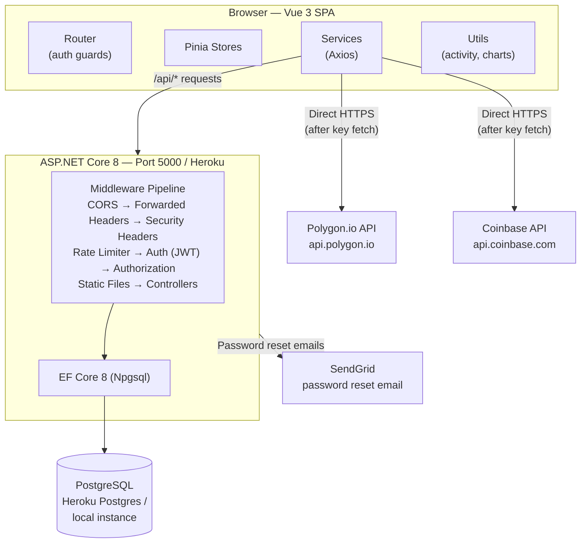
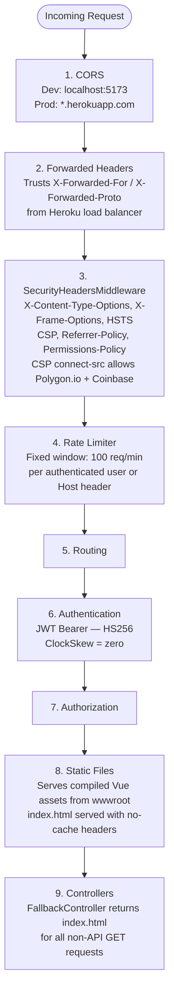
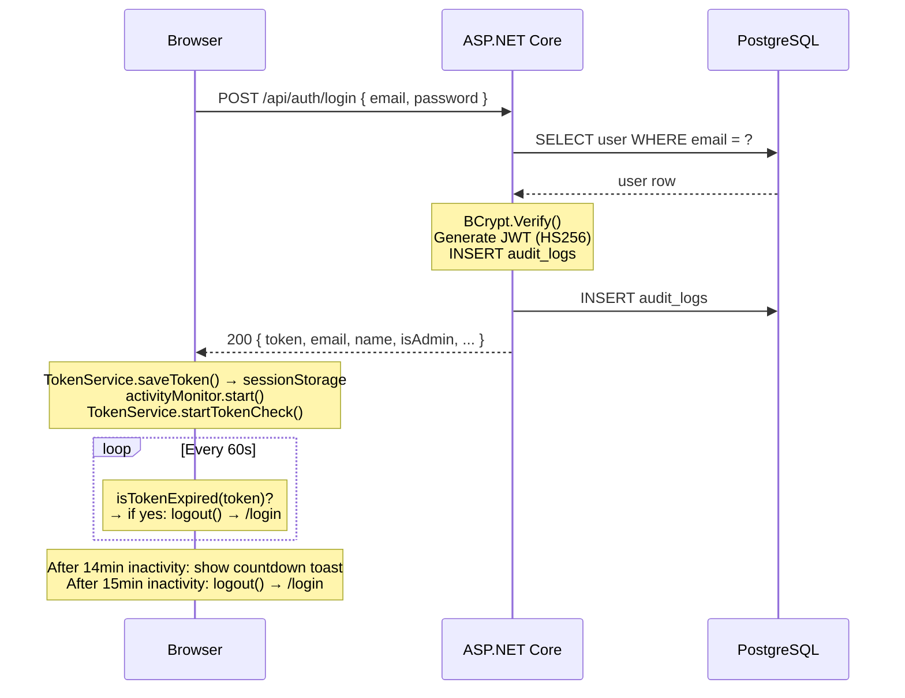
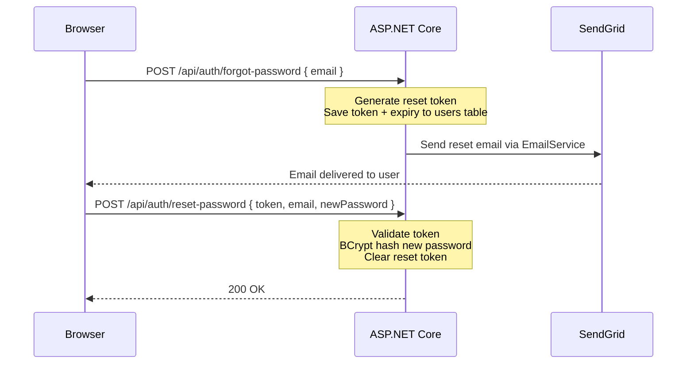
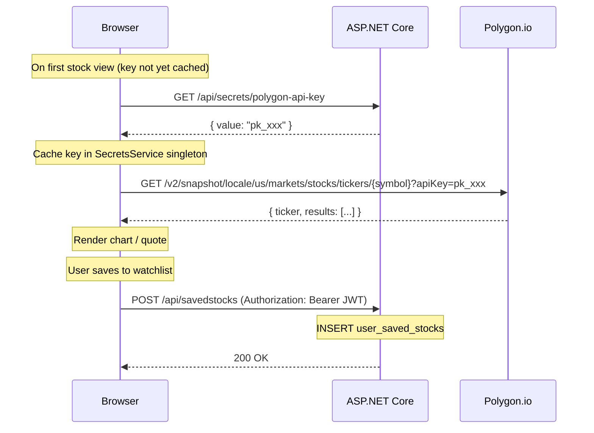
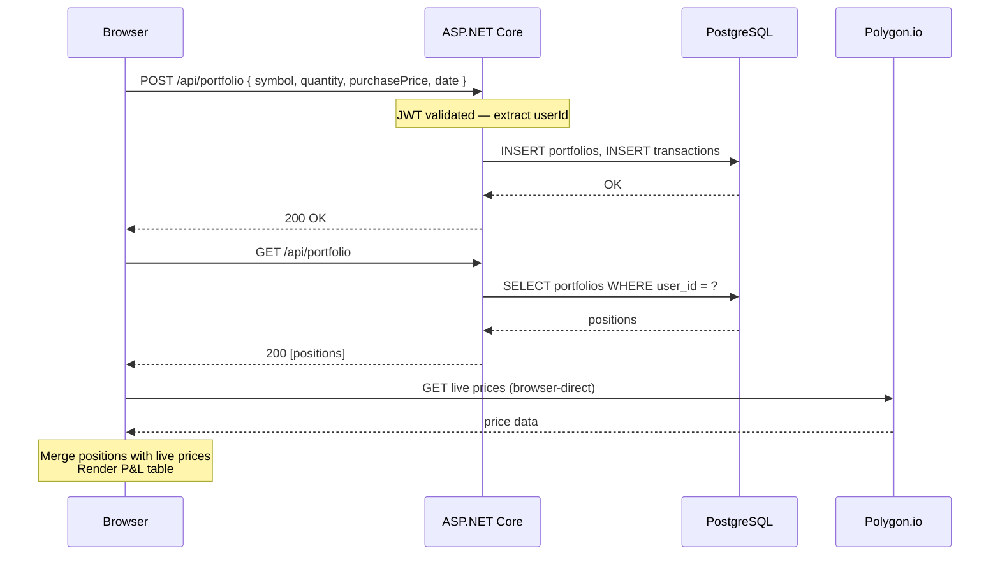

# Architecture — Investment Tracker

## Table of Contents

- [System Overview](#system-overview)
- [Architecture Diagram](#architecture-diagram)
- [Frontend Layer](#frontend-layer)
- [Backend Layer](#backend-layer)
- [Middleware Pipeline](#middleware-pipeline)
- [Data Flows](#data-flows)
  - [Authentication Flow](#authentication-flow)
  - [Stock Data Flow](#stock-data-flow)
  - [Portfolio Data Flow](#portfolio-data-flow)
- [Database Schema](#database-schema)
- [Key Dependencies](#key-dependencies)
- [Architectural Issues](#architectural-issues)
- [Future Considerations](#future-considerations)

---

## System Overview

Investment Tracker is a monorepo containing a Vue 3 single-page application and an ASP.NET Core 8 REST API. In production the backend serves the compiled frontend as static files from its `wwwroot` directory, so the entire application runs as a single Heroku dyno behind a single origin. In development the Vite dev server runs separately on port 5173 and proxies `/api` requests to the backend on port 5000.

External market data (Polygon.io for stocks, Coinbase API for crypto) is fetched directly from the browser. API keys are never bundled into the frontend build; instead, the browser retrieves them from a protected backend endpoint after authenticating, and caches them in service singletons for the duration of the session.

---

## Architecture Diagram

---

## Frontend Layer

The frontend is a Vue 3 application using the Composition API with `<script setup>` syntax throughout. It is compiled by Vite 5 into static assets written to `api/wwwroot`, from where ASP.NET Core serves them.

### Router (`src/router/index.ts`)

Vue Router 4 with HTML5 history mode. Route guards in `beforeEach` enforce two protection levels:

- `requiresAuth: true` — redirects unauthenticated users to `/login`.
- `requiresAdmin: true` — redirects non-admin authenticated users to `/access-denied`.

Auth state is initialized from `sessionStorage` on the first navigation if not already loaded.

### Stores (`src/stores/`)

Four Pinia 2 stores:

| Store | Responsibility |
|---|---|
| `auth.ts` | Authenticated user state, login/logout actions, session lifecycle |
| `search.ts` | Active stock search state |
| `searchHistory.ts` | Last 5 stock searches, persisted to `localStorage` |
| `cryptoSearchHistory.ts` | Last 5 crypto searches, persisted to `localStorage` |

### Services (`src/services/`)

Thirteen service modules. All backend communication goes through the shared Axios instance in `src/api/axios.ts`. Key services:

| Service | Responsibility |
|---|---|
| `authService.ts` | Login, register, password reset API calls |
| `tokenService.ts` | Read/write JWT and user object in `sessionStorage`; periodic token expiry check (every 60 seconds via `setInterval`) |
| `secretService.ts` | Fetches Polygon and Coinbase API keys from `/api/secrets/*`; caches in singleton fields |
| `polygonService.ts` | Direct browser-to-Polygon.io calls (quotes, history, news, related companies) |
| `coinbaseService.ts` | Direct browser-to-Coinbase API calls (crypto prices, history) |
| `portfolioService.ts` | Stock portfolio CRUD via backend |
| `cryptoService.ts` | Crypto portfolio CRUD via backend |
| `dashboardService.ts` | Watchlist and dashboard aggregation |
| `marketMoversService.ts` | Top gainers/losers via backend |

### Axios Instance (`src/api/axios.ts`)

- Base URL: `window.location.origin/api` in production; `http://localhost:5000/api` in development.
- Request interceptor: reads JWT from `sessionStorage` and sets `Authorization: Bearer <token>` on every outbound request.
- Response interceptor: on HTTP 401, clears `sessionStorage` and redirects to `/login`.

### Session Management

Two independent mechanisms enforce session termination:

1. **Token expiry check** — `TokenService.startTokenCheck()` runs `isTokenExpired()` every 60 seconds using `setInterval`. If the JWT is expired the auth store calls `logout()` and navigates to `/login`.

2. **Inactivity monitor** — `activityMonitor.ts` tracks DOM events (`mousemove`, `keydown`, etc.) via `activityEvent.ts`. If no activity is detected for 14 minutes, a countdown toast notification appears. After 15 minutes of total inactivity, `logout()` is called. Any user activity resets both timers and dismisses the warning toast.

### Components (`src/components/`)

27 components. Five are registered globally in `main.ts`:

- `NewsArticleCard`
- `CryptoSearchResult`
- `MarketStatusMessage`
- `LoadingSpinner`
- `ConfirmationModal`

The remaining 22 are imported locally within the views that use them.

---

## Backend Layer

The backend is an ASP.NET Core 8 Web API project. In production it serves dual roles: REST API and static file host for the compiled Vue SPA.

### Controllers (`api/Controllers/`)

14 controllers:

| Controller | Route prefix | Responsibility |
|---|---|---|
| `AuthController` | `/api/auth` | Register, login, forgot password, reset password |
| `SecretsController` | `/api/secrets` | Serves Polygon and Coinbase API keys to authenticated clients |
| `PortfolioController` | `/api/portfolio` | Stock portfolio positions (CRUD) |
| `CryptoPortfolioController` | `/api/cryptoportfolio` | Crypto portfolio positions (CRUD) |
| `SavedStocksController` | `/api/savedstocks` | Stock watchlist (CRUD) |
| `SavedCryptosController` | `/api/savedcryptos` | Crypto watchlist (CRUD) |
| `TransactionController` | `/api/transaction` | Buy/sell transaction ledger |
| `StockDataController` | `/api/stockdata` | Reference stock data (seeded on startup) |
| `MarketMoversController` | `/api/marketmovers` | Top gainers and losers |
| `FavoritesController` | `/api/favorites` | Favorited stocks |
| `UsersController` | `/api/users` | Admin: user management |
| `AuditController` | `/api/audit` | Admin: audit log queries |
| `LogsController` | `/api/logs` | Frontend error log ingestion |
| `FallbackController` | (catch-all) | Returns `wwwroot/index.html` for all non-API GET requests |

### Services (`api/Services/`)

| Service | Responsibility |
|---|---|
| `AuthService` | BCrypt password hashing, JWT generation, password reset token lifecycle |
| `EmailService` | SendGrid integration for password reset emails |
| `KeyVaultService` | Reads API keys from `IConfiguration` (environment variables or `appsettings.json`) |
| `StockSeederService` | Seeds the `stock_data` table with reference stock symbols on startup |

### SPA Hosting

`FallbackController.Index()` is mapped via `app.MapFallbackToController("Index", "Fallback")` in `Program.cs`. It returns `wwwroot/index.html` with `Cache-Control: no-cache` headers for any GET request that does not match an API route or a static file. This allows Vue Router's HTML5 history mode to function correctly on deep links and page refreshes.

`index.html` itself is also excluded from caching in `UseStaticFiles` so that browser-cached shell pages do not prevent new deployments from being picked up.

---

## Middleware Pipeline

The ASP.NET Core request pipeline is configured in `Program.cs` in this order:

---

## Data Flows

### Authentication Flow

**Password reset flow:**

### Stock Data Flow

### Portfolio Data Flow

---

## Database Schema

All tables use PostgreSQL snake_case naming conventions enforced via EF Core `HasColumnName` configuration.

| Table | Primary Key | Foreign Keys | Description |
|---|---|---|---|
| `users` | `id` (int) | — | User accounts. Stores BCrypt password hash, admin flag, login tracking counters, password reset token and expiry. |
| `audit_logs` | `id` (int) | — | Immutable event log. Records login success/failure, password reset attempts with timestamp and IP address. |
| `stock_data` | `id` (int) | — | Reference stock data seeded on startup. Stores symbol, price, OHLC, volume, market cap, and timestamp. Indexed on `symbol` and `timestamp`. |
| `portfolios` | `id` (int) | `user_id → users.id` | Stock portfolio positions. One row per position per user. Stores symbol, quantity, purchase price, purchase date, and notes. Cascade delete on user removal. |
| `crypto_portfolios` | `id` (int) | `user_id → users.id` | Crypto portfolio positions. Same shape as `portfolios`. Cascade delete on user removal. |
| `transactions` | `id` (int) | `user_id → users.id` | Buy/sell ledger for stocks. Indexed on `user_id`, `symbol`, and `transaction_date`. Cascade delete on user removal. |
| `user_saved_stocks` | `id` (int) | `user_id → users.id` | Stock watchlist. Unique constraint on `(user_id, symbol)`. Stores a snapshot of market data at save time (OHLC, volume, market cap). Cascade delete on user removal. |
| `user_saved_cryptos` | `id` (int) | `user_id → users.id` | Crypto watchlist. Unique constraint on `(user_id, symbol)`. Stores snapshot of price, change, 24h high/low, volume at save time. Cascade delete on user removal. |
| `market_movers` | `id` (int) | — | Top gainers and losers. Stores symbol, type (`gainer`/`loser`), and `last_updated` timestamp. |
| `user_owned_stocks` | `id` (int) | `user_id → users.id` | Legacy stock ownership table (predates `portfolios`). Cascade delete on user removal. |

---

## Key Dependencies

### Frontend

| Package | Version | Purpose |
|---|---|---|
| `vue` | ^3.5 | UI framework |
| `vue-router` | ^4.2 | Client-side routing |
| `pinia` | ^2.1 | State management |
| `axios` | ^1.6 | HTTP client |
| `chart.js` | ^4.4 | Chart rendering |
| `vue-chartjs` | ^5.3 | Vue wrapper for Chart.js |
| `tailwindcss` | ^3.4 | Utility-first CSS framework |
| `@vueuse/core` | ^10.7 | Vue composition utilities |
| `jwt-decode` | ^4.0 | Client-side JWT decoding (expiry check) |
| `vue-toastification` | ^2.0.0-rc.5 | Toast notifications (active) |
| `vue3-toastify` | ^0.2 | Toast notifications (installed but unused) |
| `sanitize-html` | ^2.13 | HTML sanitization for news content |
| `xss` | ^1.0 | XSS protection utilities |
| `vitest` | 2.1.8 | Unit test runner |
| `@vue/test-utils` | 2.4.6 | Vue component testing utilities |
| `happy-dom` | 16.2.9 | DOM environment for tests |

### Backend

| Package | Version | Purpose |
|---|---|---|
| `Microsoft.AspNetCore.Authentication.JwtBearer` | 8.0.0 | JWT Bearer authentication |
| `Microsoft.EntityFrameworkCore` | 8.0.10 | ORM |
| `Npgsql.EntityFrameworkCore.PostgreSQL` | 8.0.10 | PostgreSQL EF Core provider |
| `BCrypt.Net-Next` | 4.0.3 | Password hashing |
| `SendGrid` | 9.29.3 | Transactional email for password reset |
| `Swashbuckle.AspNetCore` | 6.5.0 | Swagger/OpenAPI (Development only) |
| `AspNetCore.HealthChecks.NpgSql` | 8.0.2 | PostgreSQL health check endpoint |

---

## Architectural Issues

### Active Security Issue — API Keys Exposed to Browser Clients

**Severity: High**

The `SecretsController` (`/api/secrets/polygon-api-key`, `/api/secrets/coinbase-api-key`, `/api/secrets/coinbase-api-secret`) returns third-party API keys in HTTP response bodies to any authenticated browser client. The `SecretsService` singleton on the frontend caches these keys in memory and uses them as request headers or query parameters when calling Polygon.io and the Coinbase API directly from the browser.

This means:

- Any authenticated user can retrieve the Polygon.io and Coinbase API keys using browser developer tools.
- The keys are visible in network traffic and JavaScript memory.
- A compromised account exposes the keys to the account holder.

The correct fix is to proxy all external API calls through the ASP.NET Core backend. The browser should never receive the keys. See [Future Considerations](#future-considerations).

---

### Technical Debt

**1. Duplicate toast library**

Both `vue-toastification` (^2.0.0-rc.5) and `vue3-toastify` (^0.2) are installed. Only `vue-toastification` is imported in `main.ts` and used in `src/utils/toast.ts`. `vue3-toastify` adds bundle weight with no benefit. It should be removed from `package.json`.

**2. Five globally registered components bypass tree-shaking**

`main.ts` registers `NewsArticleCard`, `CryptoSearchResult`, `MarketStatusMessage`, `LoadingSpinner`, and `ConfirmationModal` globally via `app.component()`. This causes all five components to be included in the initial bundle regardless of the route loaded. These components should be imported locally in the views and components that use them.

**3. Two structurally identical Pinia stores**

`searchHistory.ts` and `cryptoSearchHistory.ts` are line-for-line identical in structure, differing only in their storage key string (`stock-search-history` vs `crypto-search-history`) and the TypeScript type of the array element (`StockData` vs `CryptoData`). They should be replaced by a single generic composable — `useSearchHistory<T>(storageKey: string)` — or a parameterised Pinia store factory.

**4. Very low test coverage**

Two spec files (`Home.spec.ts` and `Landing.spec.ts`) cover 19 views, 27 components, and 13 services. Critical paths including authentication, the activity monitor, the secrets service, and all portfolio operations have no test coverage.

**5. `encryptData` performs base64 encoding, not encryption**

`src/utils/securityUtils.ts` exports an `encryptData` function that calls `Buffer.from(data).toString('base64')`. Base64 is an encoding, not encryption. The function name is misleading. A paired `decryptData` reverses the encoding. Neither function provides any security guarantee. The functions should be renamed (e.g. `encodeData` / `decodeData`) or removed if they serve no purpose.

---

## Future Considerations

**Proxy external API calls through the backend**

The highest-priority improvement. All Polygon.io and Coinbase API calls should be moved into new ASP.NET Core controller actions or a dedicated proxy service. The `SecretsController` and `SecretsService` singleton on the frontend would be removed entirely. This eliminates client-side secret exposure and makes it straightforward to add server-side caching of market data responses to reduce third-party API quota consumption.

**Generic `useSearchHistory` composable**

Replace `searchHistory.ts` and `cryptoSearchHistory.ts` with a single generic composable parameterised by storage key and item type. This removes approximately 40 lines of duplicated code and establishes a reusable pattern for any future search history requirements.

**`docker-compose.yml` for local development**

A `docker-compose.yml` defining the ASP.NET Core API and a PostgreSQL container would eliminate the local PostgreSQL installation prerequisite and standardise the development environment. Developers would run `docker compose up` instead of managing a local database instance manually.

**Backend test project**

There are no backend tests. An xUnit test project using `WebApplicationFactory<Program>` would enable integration tests for authentication, portfolio operations, rate limiting, and the middleware pipeline without requiring a live database. A `TestContainers` PostgreSQL container could provide an isolated database for each test run.

**Consolidate chart utility files**

Five files in `src/utils/` are dedicated to Chart.js configuration: `chartConfig.ts`, `chartPlugins.ts`, `chartScales.ts`, `chartTypes.ts`, and `volumeChartConfig.ts`. These could be consolidated into a single `chartUtils.ts` with named exports, reducing import noise in components that use charts.

**Replace `vue-toastification` RC with a stable release or alternative**

`vue-toastification` is pinned to `2.0.0-rc.5`, a release candidate that has been in this state since 2021. The library should either be replaced with a stable alternative (such as `vue3-toastify`, already installed) or upgraded if a stable release becomes available.
